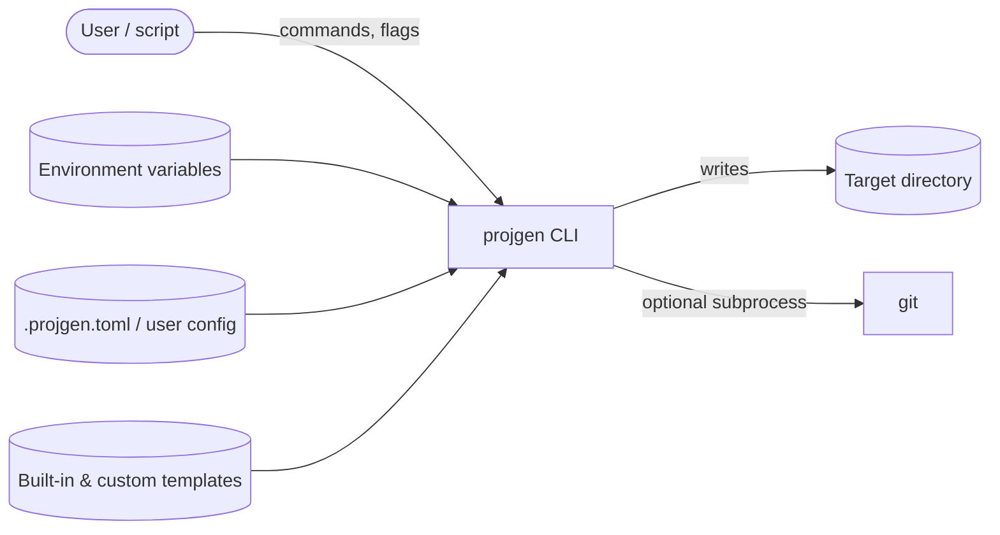
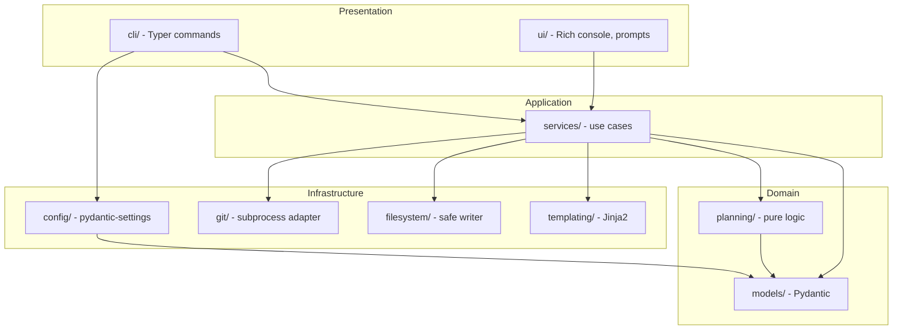
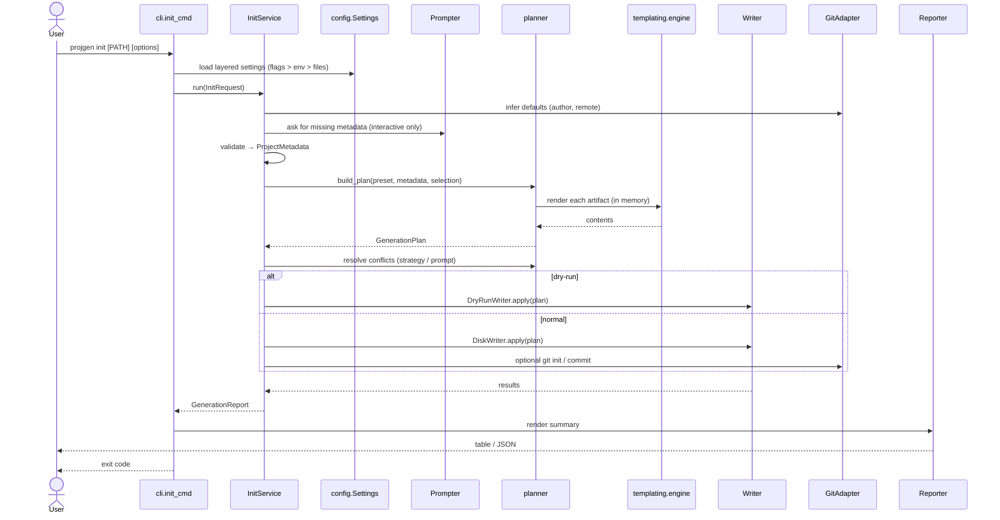
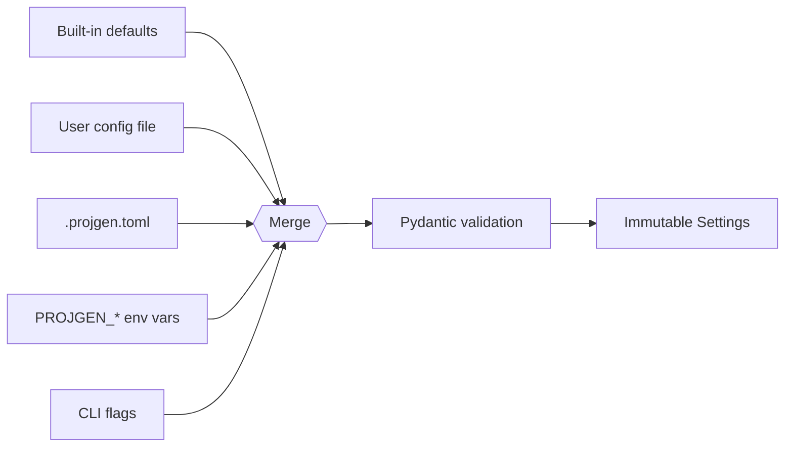

# projgen — CLI Architecture

| Field   | Value                    |
|---------|--------------------------|
| Status  | Draft                    |
| Version | 0.1.0                    |
| Date    | 2026-11-16               |
| Related | [Requirements](./requirements.md), [Tech Stack](./tech-stack.md) |

## 1. Overview

projgen is a CLI that turns a small set of user inputs (project metadata + options) into a set of
files in a target directory. Internally it is a **pipeline**:

```
inputs → settings → context → plan → render → write → report
```

1. **Collect** inputs from flags, environment, config files and prompts.
2. **Validate** them into typed models.
3. **Plan**: decide which artifacts to generate and what to do on conflicts.
4. **Render** every artifact in memory (nothing touches the disk yet).
5. **Write** the result atomically, honoring dry-run and conflict strategy.
6. **Report** a summary and return an exit code.

### 1.1 Architectural principles

| Principle | Consequence |
|-----------|-------------|
| Thin CLI, rich core (NFR-042) | Commands only parse input and call services. All logic is testable without the CLI framework. |
| Pure core, impure edges | Planning and rendering are pure functions of their inputs. Only the `filesystem`, `git` and `prompt` adapters perform I/O. |
| Validate at the boundary | Raw input is converted into Pydantic models once; everything inside works with trusted, typed data. |
| Plan before acting | Rendering and conflict detection produce a `GenerationPlan`; dry-run simply stops before the write step (FR-031, NFR-012). |
| Dependency direction | `cli → services → domain`, adapters implement interfaces owned by the core. Nothing in the core imports Typer, Rich or `questionary`. |
| Data-driven extensibility | New artifacts are declared in a preset manifest, not hard-coded in the CLI (FR-070). |

## 2. System context



projgen has no network access and no persistent state beyond the files it generates and optional
configuration files.

## 3. Layered structure



## 4. Proposed repository layout

```
projgen/
├── docs/                      # requirements, tech stack, architecture
├── src/projgen/
│   ├── __init__.py            # __version__
│   ├── __main__.py            # python -m projgen
│   ├── cli/
│   │   ├── app.py             # Typer root app, global options, error handler
│   │   ├── init_cmd.py        # `projgen init`
│   │   ├── presets_cmd.py     # `projgen presets list|show`
│   │   ├── config_cmd.py      # `projgen config show|init`
│   │   └── validate_cmd.py    # `projgen validate`
│   ├── ui/
│   │   ├── console.py         # Rich console factory (TTY / NO_COLOR aware)
│   │   ├── prompts.py         # interactive prompts behind a Prompter protocol
│   │   └── reporters.py       # summary table, diff view, JSON reporter
│   ├── config/
│   │   ├── settings.py        # pydantic-settings classes
│   │   └── sources.py         # TOML discovery (project + user via platformdirs)
│   ├── models/
│   │   ├── project.py         # ProjectMetadata, License, Branch settings
│   │   ├── preset.py          # Preset, ArtifactSpec manifest models
│   │   ├── plan.py            # GenerationPlan, PlannedFile, ConflictStrategy
│   │   └── result.py          # FileResult, GenerationReport
│   ├── services/
│   │   ├── init_service.py    # orchestrates the pipeline
│   │   ├── preset_service.py  # load / list / validate presets
│   │   └── config_service.py  # effective-config introspection
│   ├── planning/
│   │   ├── planner.py         # builds GenerationPlan from preset + settings
│   │   └── conflicts.py       # conflict detection and resolution rules
│   ├── templating/
│   │   ├── engine.py          # sandboxed Jinja2 environment
│   │   ├── loaders.py         # built-in + custom directory loader chain
│   │   └── context.py         # builds the template context from models
│   ├── filesystem/
│   │   ├── safe_path.py       # path normalization & traversal protection
│   │   └── writer.py          # atomic writes, backup, dry-run writer
│   ├── git/
│   │   └── adapter.py         # init / config lookup / commit via subprocess
│   ├── presets/               # built-in presets (data, shipped in the wheel)
│   │   └── default/
│   │       ├── preset.toml    # manifest: artifacts, defaults
│   │       └── templates/
│   │           ├── README.md.j2
│   │           ├── github/ISSUE_TEMPLATE/{bug_report,feature_request,task}.md.j2
│   │           ├── github/pull_request_template.md.j2
│   │           └── github/workflows/check-branch.yml.j2
│   └── errors.py              # exception hierarchy + exit-code mapping
└── tests/
    ├── unit/                  # pure logic: models, planner, safe_path, engine
    ├── integration/           # filesystem, git, service pipeline in tmp_path
    ├── e2e/                   # CliRunner: full commands, exit codes
    └── snapshots/             # syrupy golden files for generated artifacts
```

## 5. Module reference

### 5.1 `cli/` — presentation layer

**Responsibility:** declare commands, options and arguments; translate them into service calls;
map exceptions to exit codes. Contains *no* business logic (NFR-042).

| Command | Purpose | Requirements |
|---------|---------|--------------|
| `projgen init [PATH]` | Generate the scaffolding. Options: `--preset`, `--only`, `--skip`, `--force`, `--dry-run`, `--no-input`, `--git-init`, `--commit`, `--templates-dir`, `--output`. | FR-001…007, 020, 022, 030…035, 060…062 |
| `projgen presets list` / `show <name>` | Inspect available presets and their artifacts. | FR-021 |
| `projgen config show` / `init` | Show effective configuration with value origins; write a starter `.projgen.toml`. | FR-042, FR-043 |
| `projgen validate [PATH]` | Validate presets / custom templates. | FR-024 |
| Global options | `--version`, `--verbose`, `--quiet`, `--debug`, `--no-color`. | FR-051, FR-053, NFR-013 |

`cli/app.py` also hosts a **single top-level error handler**: it catches `ProjgenError`
subclasses, prints a friendly message through the reporter, and exits with the mapped code;
unexpected exceptions are shown as a short message unless `--debug` is set.

### 5.2 `ui/` — terminal interaction

| Component | Responsibility |
|-----------|----------------|
| `console.py` | Builds the Rich `Console`; disables color/animation when not a TTY or when `NO_COLOR` is set (NFR-021/022). |
| `prompts.py` | Defines a `Prompter` protocol (`ask_text`, `ask_choice`, `ask_confirm`, `ask_multi`) with an interactive implementation and a non-interactive one that raises a validation error for missing values. Tests inject a scripted fake. |
| `reporters.py` | Renders `GenerationReport` as a Rich table (default), plain text, or JSON (FR-052, FR-055), and shows diffs (FR-033). |

### 5.3 `config/` — layered settings

Implements FR-040…FR-043 with `pydantic-settings`.

- `Settings` (a `BaseSettings`) holds global defaults: preset, default branch, license, conflict
  strategy, newline style, etc., with env prefix `PROJGEN_`.
- `sources.py` locates the project file (`.projgen.toml` in the target directory or its parents)
  and the user file (`platformdirs.user_config_dir("projgen")`), and wires them in through
  `settings_customise_sources`.
- **Precedence** (highest first): CLI flags → environment → project TOML → user TOML → defaults.
  CLI flags are applied by passing them as init kwargs only when explicitly provided.
- `config show` uses the same machinery but records which source supplied each field.

### 5.4 `models/` — domain models (Pydantic v2)

All models are immutable (`frozen=True`) and strict where practical.

| Model | Key fields / validation |
|-------|-------------------------|
| `ProjectMetadata` | `name` (slug-safe, non-empty), `description`, `author`, `license` (SPDX enum), `default_branch`, `repository_url` (`AnyUrl` optional). Field validators sanitize and reject control characters. |
| `Preset` | `name`, `version`, `description`, `artifacts: list[ArtifactSpec]`, default variables. |
| `ArtifactSpec` | `id`, `group` (e.g. `issue-templates`, `ci`, `docs`), `template` path, `destination` (relative, templated path), `enabled_by_default`, optional `requires` conditions. |
| `ConflictStrategy` | Enum: `ask`, `skip`, `overwrite`, `backup`. |
| `PlannedFile` | `artifact_id`, `destination` (validated relative `Path`), `content`, `status` (`create` / `unchanged` / `conflict`), `existing_digest`. |
| `GenerationPlan` | Ordered `list[PlannedFile]`, derived summary counts. |
| `FileResult` / `GenerationReport` | Outcome per file (`created`, `skipped`, `overwritten`, `backed_up`, `unchanged`, `failed`), overall status, dry-run flag. |

### 5.5 `planning/` — pure planning logic

- `planner.build_plan(preset, metadata, selection, target_dir, reader)` selects artifacts
  (`--only` / `--skip` / defaults), renders them through the template engine, and compares each
  result with what is already on disk via an injected read-only `FileReader`. It returns a
  `GenerationPlan` and performs no writes.
- `conflicts.resolve(plan, strategy, prompter)` turns `conflict` entries into concrete actions
  (skip / overwrite / backup), asking the user only when the strategy is `ask` and the session is
  interactive. Identical content is classified `unchanged`, which makes runs idempotent (NFR-011).

### 5.6 `templating/` — rendering

| Component | Responsibility |
|-----------|----------------|
| `engine.py` | Creates a `SandboxedEnvironment` with `StrictUndefined`, `keep_trailing_newline=True`, deterministic settings, and a small allow-list of custom filters (`slug`, `snake`, `year`—year only if explicitly injected, to preserve determinism). |
| `loaders.py` | `ChoiceLoader`: custom `--templates-dir` first (override), then the preset's packaged templates via `importlib.resources`. |
| `context.py` | Builds the template context (`project`, `git`, `options`) from validated models. This is the **documented template API**: adding a variable here is a public change. |

Destination paths are templates too (e.g. `{{ docs_dir }}/architecture.md`), rendered with the same
engine and then validated by `safe_path`.

### 5.7 `filesystem/` — safe I/O

| Component | Responsibility |
|-----------|----------------|
| `safe_path.py` | `resolve_inside(target_dir, relative)` normalizes the path and raises `UnsafePathError` if the result escapes the target directory, is absolute, or crosses a symlink leaving the root (FR-035, NFR-061). The most heavily tested module (property tests). |
| `writer.py` | `Writer` protocol with two implementations: `DiskWriter` (creates parent dirs, writes to a temp file in the same directory then `os.replace` for atomicity — FR-034; `.bak` backups — FR-032; UTF-8 + configured newlines — NFR-032) and `DryRunWriter` (records actions only — FR-031). |

### 5.8 `git/` — optional integration

`GitAdapter` wraps `subprocess.run(["git", ...])` with `shell=False`, explicit `cwd`, timeouts and
typed results. Operations: `is_repo`, `config_get(key)`, `init(branch)`, `create_branch`,
`commit_all(message)`, `remote_url()`. If `git` is not installed the adapter reports `unavailable`
and callers degrade gracefully (FR-007, FR-060…062). Defined behind a protocol so tests use a fake.

### 5.9 `services/` — application use cases

`InitService.run(request) -> GenerationReport` is the orchestrator:



Other services: `PresetService` (discover, load and validate presets and manifests; powers
`presets list` and `validate`) and `ConfigService` (effective-config report).

### 5.10 `errors.py` — error model

```
ProjgenError                      exit 1
├── UsageError                    exit 2   bad flag combination, missing arg in --no-input
├── ValidationError (wrapper)     exit 3   invalid metadata/config/preset (wraps pydantic errors)
│   └── TemplateError             exit 3   undefined variable, syntax error (with file + line)
├── ConflictError                 exit 4   existing files and user declined / no --force
├── UnsafePathError               exit 3   path traversal attempt
└── ExternalToolError             exit 1   git failure
```

Each error carries `message`, `hint` (how to fix, NFR-020) and an optional `details` payload. Pydantic
validation errors are converted into this hierarchy at the service boundary so the CLI never
formats raw Pydantic output.

## 6. Key flows

### 6.1 `projgen init` (happy path)

1. Typer parses arguments and global flags; logging/console verbosity is configured.
2. `Settings` is loaded with layered sources; explicit flags override everything.
3. `InitService` infers defaults from git and the directory name, then prompts for any missing required
   metadata (skipped under `--no-input`, where absence is a `UsageError`).
4. Metadata is validated into `ProjectMetadata` (fails fast with field-level messages).
5. The preset is loaded and validated; artifacts are filtered by `--only` / `--skip`.
6. All artifacts are rendered **in memory**; any template error aborts before any write (NFR-012).
7. The plan is diffed against the disk; conflicts are resolved per strategy.
8. The writer applies the plan (or only simulates it, for `--dry-run`).
9. Optional git steps run.
10. The report is printed and the exit code is returned.

### 6.2 Conflict handling

| Existing file | Content identical | Strategy | Result |
|---------------|-------------------|----------|--------|
| No | — | any | `created` |
| Yes | Yes | any | `unchanged` (no write) |
| Yes | No | `skip` | `skipped` |
| Yes | No | `overwrite` / `--force` | `overwritten` |
| Yes | No | `backup` | `backed_up` + `overwritten` |
| Yes | No | `ask` + interactive | prompt per file (with diff option) |
| Yes | No | `ask` + non-interactive | `ConflictError` (exit 4) |

### 6.3 Configuration resolution



## 7. Presets and template manifest

A preset is a directory containing `preset.toml` and a `templates/` tree.

```toml
# preset.toml
name = "default"
version = "1.0.0"
description = "Standard repository scaffolding with strict GitHub templates."

[[artifacts]]
id = "readme"
group = "docs"
template = "README.md.j2"
destination = "README.md"

[[artifacts]]
id = "issue-bug"
group = "issue-templates"
template = "github/ISSUE_TEMPLATE/bug_report.md.j2"
destination = ".github/ISSUE_TEMPLATE/bug_report.md"

[[artifacts]]
id = "ci-branch-flow"
group = "ci"
template = "github/workflows/check-branch.yml.j2"
destination = ".github/workflows/check-branch.yml"
```

The manifest is parsed with `tomllib` into the `Preset` model. Because artifacts are data, adding or
removing one is a template + manifest change only (FR-070). The templates in the projgen repo's own
`.github/` directory are the reference for the `default` preset content.

## 8. Cross-cutting concerns

| Concern | Approach |
|---------|----------|
| **Logging** | Standard `logging` with a Rich handler; levels driven by `--verbose/--quiet/--debug`. User-facing results go through reporters, not logs. |
| **Determinism** | No clock or randomness in the core; any date/year is injected via the context. Sorted artifact order. Stable newline handling. |
| **Security** | Sandboxed Jinja2, `safe_path` confinement, `shell=False` subprocesses, no network, no telemetry. |
| **Performance** | Lazy imports for Rich/questionary/Jinja2 inside commands; a fixed, small set of templates. |
| **Portability** | `pathlib` only; atomic replace works on Windows; line endings normalized on write. |
| **i18n** | English only (NFR-083); message strings centralized in `errors.py`/`reporters.py` to ease a future change. |
| **Observability** | `--output json` provides a structured result for scripts; `--debug` prints tracebacks. |

## 9. Testing strategy

| Level | Scope | Techniques |
|-------|-------|-----------|
| Unit | models, `planner`, `conflicts`, `engine`, `context`, `safe_path`, config precedence | Pure functions; `tmp_path`; fakes for `FileReader`; Hypothesis for `safe_path`. |
| Integration | `DiskWriter` (atomicity, backups, newline), `GitAdapter` against a real temporary git repo, `InitService` with a scripted `Prompter` | `tmp_path`, `monkeypatch` env/cwd, `pytest.mark.git` skipped if `git` is missing. |
| End to end | Every CLI command through `CliRunner`, exit codes, dry-run output, JSON output, non-interactive failures | Assert on exit code, stdout, and the resulting tree. |
| Snapshot | Rendered artifacts for each preset | `syrupy`; one snapshot per artifact guards against accidental template drift (NFR-052). |
| Contract | Every built-in preset validates; every template renders with a sample context | Parametrized over presets/artifacts (FR-024). |

**Test seams:** `Prompter`, `Writer`, `FileReader`, `GitAdapter` are protocols injected into services,
so tests never need to mock the terminal or global state.

## 10. Extension points

| Want to… | Do this |
|----------|---------|
| Add a generated file | Add a template + an `[[artifacts]]` entry in the preset manifest. |
| Add a preset | Create a new directory under `presets/` (built-in) or pass `--templates-dir`/preset path (custom). |
| Add a template variable | Extend `ProjectMetadata` and `templating/context.py`; document it; add a snapshot test. |
| Add a command | Add a module in `cli/`, register it in `cli/app.py`, delegate to a new service. |
| Support another forge (GitLab…) | New preset + artifact destinations; no core changes expected. |
| Third-party presets | Entry points group `projgen.presets` (future, FR-071). |

## 11. Requirement coverage map

| Area | Primary modules |
|------|-----------------|
| FR-001…007 (init, prompts, non-interactive) | `cli/init_cmd`, `services/init_service`, `ui/prompts`, `models/project` |
| FR-010…018 (artifacts) | `presets/default`, `templating/` |
| FR-020…024 (presets, templates) | `services/preset_service`, `models/preset`, `templating/loaders` |
| FR-030…035 (safety) | `planning/conflicts`, `filesystem/` |
| FR-040…043 (config) | `config/`, `cli/config_cmd` |
| FR-050…056 (UX) | `cli/`, `ui/`, `errors.py` |
| FR-060…062 (git) | `git/adapter` |
| NFR-010…013 (reliability) | `planning/`, `templating/engine`, `errors.py`, `cli/app` |
| NFR-040…044 (maintainability) | layered structure, tooling in [Tech Stack](./tech-stack.md) |
| NFR-050…054 (testing) | `tests/`, §9 |
| NFR-060…064 (security) | `templating/engine`, `filesystem/safe_path`, `git/adapter` |

## 12. Suggested implementation roadmap

| Milestone | Scope |
|-----------|-------|
| **M0 — Foundation** | `pyproject.toml`, src layout, Ruff/mypy/pytest in CI, `--version`, error model. |
| **M1 — Core pipeline** | Models, template engine, `default` preset, `planner`, `DiskWriter`, `projgen init` (non-interactive, `--dry-run`, `--force`). |
| **M2 — UX** | Interactive prompts, Rich reporter, conflict strategies, config layering. |
| **M3 — Extras** | Git integration, `presets`/`config`/`validate` commands, JSON output, shell completion. |
| **M4 — Release** | Snapshot suite, coverage gate, packaging, PyPI release workflow, README command reference. |

## 13. Open architectural questions

1. Should `--templates-dir` override single templates only, or also allow a complete custom manifest?
2. Is a generated-files lock/manifest (e.g. `.projgen.lock` with template version and checksums) desirable
   to enable a future `projgen update`?
3. Should the year/date appear in generated files (e.g. LICENSE)? If so, it must be injected, with an
   override flag to keep tests deterministic.
